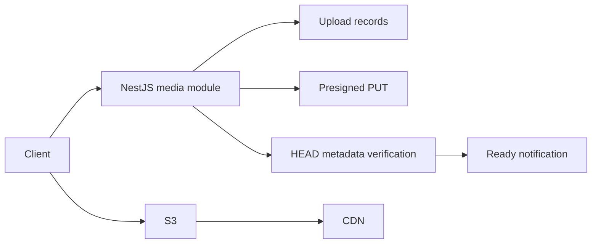

# Backend Media Platform

[](https://github.com/yashybm30/backend-platform-cicd/actions/workflows/ci.yml)

An independently runnable portfolio project demonstrating tenant/user-scoped upload metadata and short-lived s3 presigned put urls.

## Implemented behavior

- Tenant/user-scoped upload metadata and short-lived S3 presigned PUT URLs
- Restricted image MIME types and a 10 MiB declared-size cap
- HEAD verification before idempotent upload completion
- CDN URL derivation and transactional ready notifications
- Local S3-compatible service and repeatable PostgreSQL migration

## Architecture



## Requirements and setup

Node.js 24 and npm. Docker Engine with Compose v2 is needed for local databases/queues. Native browser scraping also requires Chromium. Exact dependencies and reproducible versions are in package.json/package-lock.json.

```bash
npm ci
npm run check
```

```bash
cp .env.example .env
# Edit the environment before starting; use random independent signing secrets.
docker compose --env-file .env up --build -d
```

Run one stack at a time because localhost development ports overlap. For native execution, run `npm run build`, start the documented dependencies, apply migrations where applicable, then `npm start`. Node reads `.env` for the start and SQL migration scripts; Vitest requires exported test environment variables. Bash examples use `NAME=value command`; PowerShell uses `$env:NAME='value'` before the command.

PostgreSQL migrations: `npm run db:migrate` after `npm run build`. `DATABASE_URL` selects the database; optional `PGSCHEMA` selects an isolated SQL schema. Migrations create and version the initial schema. Use a separate DDL-capable migration connection and a restricted runtime role in production. Compose uses development-only credentials and must not be exposed as production database configuration.

## Configuration

- `PORT`: HTTP port (default 3000).
- `JWT_SECRET`: at least 48 random characters; match the trusted issuer when using auth-service tokens.
- `JWT_ISSUER` / `JWT_AUDIENCE`: default `portfolio-auth` / `portfolio-api`.
- `CORS_ORIGIN`: comma-separated browser origins, deny cross-origin by default.
- `REDIS_URL`: local Redis connection where applicable.
- `DATABASE_URL`: PostgreSQL connection, with credentials injected outside source control.
- `PGSCHEMA`: SQL schema name, default `public`; validated as a bounded identifier.
- `S3_BUCKET`, `CDN_ORIGIN`, `AWS_REGION`: object store and delivery configuration.
- `S3_ENDPOINT`, `S3_PUBLIC_ENDPOINT`: local/internal and externally reachable S3 origins.
- AWS credentials: SDK provider chain in production; example local values only in development.

## Usage and contracts

POST `/v1/media/uploads` with `{contentType,bytes}` returns `{id,uploadUrl,expiresIn,headers}`. PUT the binary body to that URL using the declared content type and size. Then POST `/v1/media/:id/complete`. Completion verifies S3 metadata, transitions pending → ready and creates one inbox record in the same SQL transaction. Repeating completion does not duplicate the notification. GET `/v1/media` lists only the caller's ready uploads. GET `/v1/notifications` and PATCH `/v1/notifications/:id/read` are also tenant/user-scoped.

Configure `S3_BUCKET`, `AWS_REGION`, and `CDN_ORIGIN`. AWS production uses the SDK credential provider chain, ideally a workload role. Local testing uses `S3_ENDPOINT` and example local keys. `S3_PUBLIC_ENDPOINT` separates the hostname used to sign URLs for host clients from the internal service hostname. Compose starts Adobe S3Mock with a `media` bucket; this verifies S3 API behavior, not a production object store.

`CDN_ORIGIN` must use HTTPS except localhost. Production CDN routing, origin access policy and cache headers are deployment responsibilities. Returned CDN URLs are suitable for intentionally public media only; use signed distribution URLs for private assets. S3Mock does not implement CloudFront and does not certify CDN delivery.

### Authentication and health

Authenticated HTTP examples use `Authorization: Bearer $ACCESS_TOKEN`. Obtain a correctly scoped token from your trusted issuer or the portfolio auth service using the same signing/issuer/audience settings. No production debug token endpoint is exposed. GET `/health/live` verifies the process; GET `/health/ready` checks the project's primary dependencies. `/docs` exposes route documentation; request examples here define the detailed contracts.

## Validation

```bash
npm run check
npm run test:integration  # requires actual local dependencies, where a suite exists
```

Unit tests never imply integration success. Integration suites use disposable namespaces and test signing keys; never point them at production. Tests import compiled application modules to preserve NestJS decorator metadata. See Actions for the current hosted status. External provider calls and cloud deployments are not part of local acceptance.

## Deployment and operations

The Dockerfile uses a separate build stage and a non-root runtime. Start dependencies and migrations before the application. Compose is a local development setup. For GCP/GKE or another cloud, publish a reviewed image, inject secrets using the platform secret manager, configure private dependency connectivity, health probes and resource limits, and verify graceful shutdown. No paid cloud resource is created by this repository.

## Security and trade-offs

Bearer identity is verified with an explicit JWT algorithm, issuer, audience and structured claims. Tenant IDs come from verified tokens, not headers. New services validate access-token expiry but do not introspect the authentication service for immediate token revocation; use short-lived tokens or add an introspection boundary where required. Limits and permission checks are documented per endpoint. Use TLS, workload credentials, restricted networks, backups, request quotas and least-privilege runtime roles before real deployment.

## Known limitations

No cloud account was provisioned. MIME metadata does not prove file content safety: add byte-level format validation, malware scanning and an upload quarantine before accepting real untrusted images. Presigned uploads need ingress limits and lifecycle cleanup for abandoned pending objects. CDN delivery is configured, not cloud-verified.

## Roadmap

Expand failure-mode coverage, validate external integrations in a staging account, add deployment-specific telemetry and retention policy, and review action/dependency updates regularly. Features described above are implemented; this roadmap is not a completion claim.

MIT licensed. See CONTRIBUTING.md and SECURITY.md.

### Standalone development identities

For a disposable local setup without a separate identity server, set the same random `JWT_SECRET` as the API and run `npm run token:dev -- <subject-uuid> <tenant-uuid> <admin-or-member>`. The CLI prints a 15-minute token; it is disabled when `NODE_ENV=production`. Keep it in your shell session, never commit it or paste it into issues. This is a local development utility, not a public login endpoint. Production must use a trusted identity issuer.
